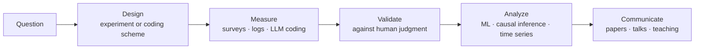

# Haoran Shi

**Behavioral scientist (PhD, LSE)** · I study how people make choices and why they stay committed, using experiments, survey and behavioral data at scale, and AI-assisted measurement checked against human judgment.

📍 London · 🎓 PhD viva 11 Nov 2026 · 🔎 Open to roles in behavioral insights, experimentation, quantitative UX research, public-opinion research and AI-adoption consulting from 13 Dec 2026

---

## Featured work

| Project | Question | Scale | Key result | Links |
|---|---|---|---|---|
| **Branding at the Water's Edge** (Paper 3) | How did US news represent each party's position on Ukraine aid? | 37,312 sentences from 11,819 articles, LLM-coded | Partisan gap widened **~40% in three event-linked steps**; LLM agreed with human coders at **r = .80** | [Preprint](https://doi.org/10.31235/osf.io/c8ygf_v2) · [Code](https://github.com/Sherlock-Shi/Branding-At-Waters-Edge_HRSHI_Reproducibility-Package) · Talk at IC2S2 2026 |
| **Commenting at the Water's Edge** (Paper 4) | Do clearer party signals change how people post? | 217,494 Reddit comments, 5-task coding scheme | Chose a model at **~$0.39 per 1,000 comments** (a fifth of the premium option) with **86–89%** human agreement; clearer signals made partisanship **more visible (~70%) than more intense (~30%)** | [Data](https://doi.org/10.5281/zenodo.22872992) · [Code](https://github.com/Sherlock-Shi/Commenting-At-Waters-Edge_HRSHI_Reproducibility-Package) |
| **What keeps people committed?** (Paper 2) | Which factors predict commitment, and which predict change? | 24,000+ British Election Study respondents | Models using a quarter of 100+ factors **more than doubled baseline performance**; emotion anchors loyalty, issues and the economy move it | [Code](https://github.com/Sherlock-Shi/NHB_CodeAccess) |
| **Predictors of partisan strength** (Paper 1) | What drives party loyalty? | 26,148 records screened across 9 databases | Distilled 50 studies into **56 drivers in 10 themes**; led a 9-author team | [Published 2024](https://doi.org/10.1057/s41599-024-03974-7) |
| **pi-codex-kit** | Can useful features from other coding agents work inside Codex? | 3 hooks + 1 git hook · 2 MCP servers built, 1 integrated · 20 skills (8 adapted, credited) | Brought features from the pi agent and Qoder to Codex as **additive add-ons**, each with install, verification and rollback steps | [Repo](https://github.com/Sherlock-Shi/pi-codex-kit) |

## How I work

- **Experiments:** factorial online RCTs (e.g. 385 participants on choice design)
- **AI at scale:** LLM pipelines on 250,000+ texts; models chosen on accuracy *and* cost
- **Open science:** public code and data for both text-analysis studies

## Toolbox

## Beyond research

Teaching (rated 4.8/5 in Social Psychology, school average 4.5; AFHEA) · supervised 5 student research teams, 4 of which won awards · music producer · film photographer
